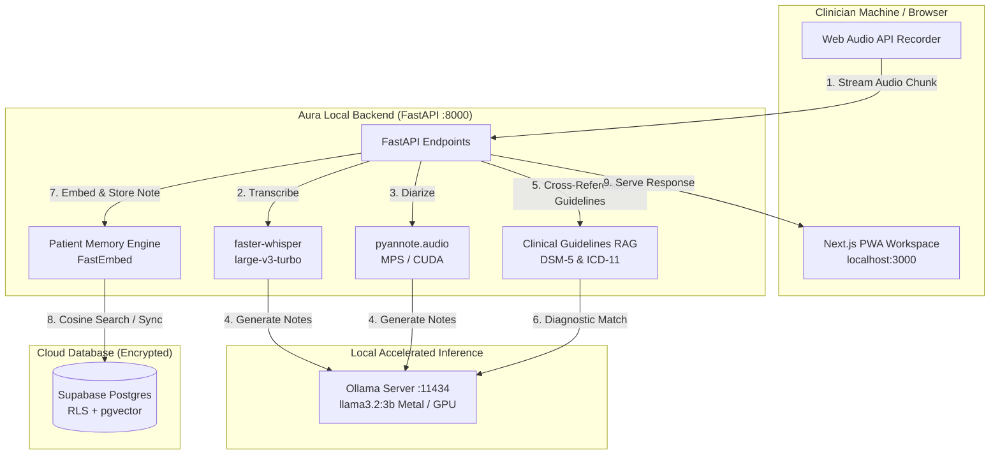

# Aura — Clinical Scribe & Diagnostic Workspace

Privacy-first clinical session documentation, semantic memory, and diagnostic guidelines cross-referencing for clinical psychologists and mental health practitioners.

Record a session, transcribe it **100% locally** with **Whisper large-v3-turbo** (with speaker diarization), generate structured SOAP notes and summaries automatically, cross-reference symptoms against **DSM-5-TR / ICD-11 diagnostic guidelines** via local RAG, and query longitudinal session history using private **Patient Memory**.

Every heavy AI computation — speech-to-text, speaker diarization, vector embeddings, semantic RAG, and LLM reasoning — executes **on-device** with hardware acceleration (Apple Silicon MPS / Metal or Nvidia CUDA). Zero audio or private clinical data ever leaves the clinician's machine.

---

## Key Features

- 🎙️ **Local Audio Transcription & Diarization**:
  - High-accuracy local speech-to-text with **Whisper `large-v3-turbo`** via `faster-whisper` (CTranslate2 int8).
  - Multi-speaker segmentation (`Speaker 1` / `Speaker 2`) using **`pyannote.audio`**.
  - Ephemeral audio lifecycle: raw audio is processed strictly in temporary memory and purged immediately upon note generation.
- 📖 **Clinical Guidelines RAG (DSM-5-TR & ICD-11)**:
  - Local vector retrieval over standard diagnostic manuals (MDD, GAD, Panic Disorder, PTSD, OCD, ADHD, BPD, Insomnia, etc.).
  - Automatic cross-referencing of observed session symptoms against criteria checklists with met/unmet verification and differential rule-out considerations.
- 🧠 **Semantic Patient Memory**:
  - Longitudinal semantic search across historical notes and transcripts using local embeddings (`BAAI/bge-small-en-v1.5` / `fastembed`) and Supabase `pgvector` HNSW indexes.
  - Ask clinical questions in natural language (*"What coping strategies have we tried for anxiety?"*) and receive contextual synthesis with direct note citations.
- 📝 **Structured Clinical Documentation**:
  - Automated SOAP note generation (Subjective, Objective, Assessment, Plan).
  - Clinician-tailored summaries and treatment goal tracking.
  - Instant PDF export of clinical notes and transcripts.
- 📅 **Practice Management & Scheduling**:
  - Client roster management with full name display and clinical records.
  - Interactive appointment calendar with offline-capable Web Push notifications and in-app reminders.
- 🔒 **Enterprise-Grade Privacy & Security**:
  - Database protected by Row Level Security (RLS) scoping all records to the clinician's authenticated identity.
  - Zero third-party cloud AI APIs (no external OpenAI/Google dependencies).

---

## Technology Stack

| Layer | Technology |
| :--- | :--- |
| **Frontend** | Next.js 16 (App Router, RSC), Tailwind CSS v4, Framer Motion, Lucide Icons, Canvas/WebGL Audio Visualizer |
| **Backend API** | Python 3.12, FastAPI, Uvicorn, Pydantic v2 |
| **Auth & Database** | Supabase (PostgreSQL with Row Level Security + `pgvector` extension) |
| **Speech-to-Text** | Whisper **`large-v3-turbo`** via `faster-whisper` (CTranslate2, int8 / float16) |
| **Diarization** | `pyannote.audio` (PyTorch with Apple Silicon MPS Metal / Nvidia CUDA acceleration) |
| **Guidelines RAG & Embeddings** | `fastembed` (`BAAI/bge-small-en-v1.5` ONNX embeddings, in-memory cosine index) |
| **Local LLM Reasoning** | Ollama (`llama3.2:3b` / `mistral` / `llama3`), running natively on GPU/MPS with heuristic fallback |
| **Reverse Proxy & Tunneling** | Cloudflare Tunnel (`cloudflared`) & Docker Compose |

---

## System Architecture



---

## Quick Start (Docker Deployment)

The fastest and cleanest way to run Aura locally with all microservices pre-configured:

### 1. Clone & Configure Environment

```bash
git clone https://github.com/PavanAksshay/aura.git
cd aura

# Copy and edit your environment variables
cp .env.example .env
```

Ensure your `.env` contains your Supabase credentials:
```env
SUPABASE_URL=https://your-project.supabase.co
SUPABASE_SERVICE_ROLE_KEY=your-service-role-key
SUPABASE_JWT_SECRET=your-jwt-secret
NEXT_PUBLIC_SUPABASE_ANON_KEY=your-anon-key

WHISPER_MODEL=large-v3-turbo
WHISPER_COMPUTE_TYPE=int8
WHISPER_DEVICE=auto
ENABLE_DIARIZATION=true
OLLAMA_URL=http://ollama:11434
SUMMARY_MODEL=llama3.2:3b
```

### 2. Launch Services

```bash
docker compose up -d
```

- **Frontend Application**: [http://localhost:3000](http://localhost:3000)
- **Backend API Health**: [http://localhost:8000/api/v1/health](http://localhost:8000/api/v1/health)
- **API Documentation**: [http://localhost:8000/docs](http://localhost:8000/docs) (available in development mode)
- **Public Tunnel Status**: View live tunnel logs with `docker logs aura-tunnel`

---

## Rate Limiting & Resource Protection

Aura enforces a 3-tier safety valve to protect local CPU/GPU compute and ensure high availability across multi-user environments:

### 1. Per-User Burst Rate Limiting (`app.core.ratelimit`)
Authenticated endpoints use an in-memory sliding window limiter scoped to `user.id`. Excess requests receive `HTTP 429 Too Many Requests` with a dynamic `Retry-After` header:

| Endpoint | Operation | Limit Window |
| :--- | :--- | :--- |
| `POST /api/v1/transcriptions` | Session audio upload & Whisper transcription | **10 requests / 5 minutes** |
| `POST /api/v1/sessions/{id}/regenerate-note` | Redraft SOAP note via local LLM | **10 requests / 1 minute** |
| `POST /api/v1/sessions/{id}/summary` | Generate session summary | **20 requests / 1 minute** |
| `POST /api/v1/memory/ask` | Patient Memory AI Question & Answer | **20 requests / 1 minute** |
| `POST /api/v1/sessions/{id}/swap-speakers` | Speaker turn re-labeling | **20 requests / 1 minute** |
| `GET /api/v1/memory/search` | Semantic note vector search | **60 requests / 1 minute** |
| `GET /api/v1/sessions/recent` | Session history polling | **30 requests / 1 minute** |

### 2. Daily AI Quota Guard (`app.core.quota`)
- **Operator Exemption:** The system operator (`OWNER_EMAIL` in `.env`) has **unlimited** daily AI invocations.
- **Guest / Multi-User Cap:** Secondary clinician accounts are capped at `AI_DAILY_LIMIT` requests/day (tracked in Postgres) to prevent resource exhaustion.
- **Core Recording Protected:** Recording and standard transcription are never throttled by the daily quota, ensuring clinicians can always document live sessions.

### 3. Hardware Concurrency Control (`app.services.retention`)
- Transcription and PyAnnote diarization pipelines are protected by a global bounded semaphore (`MAX_CONCURRENT_TRANSCRIPTIONS=1` default). Additional simultaneous uploads queue safely rather than competing for VRAM.

---

## Manual Developer Setup

If developing locally without Docker:

### 1. Database Migrations
Apply all migration files sequentially from `supabase/migrations/` (0001 to 0014) in your Supabase SQL Editor.

### 2. Backend Service
```bash
cd backend
python3.12 -m venv .venv
source .venv/bin/activate
pip install -e ".[dev,ml,diarization]"

# Start local Ollama model in another terminal
ollama run llama3.2:3b

# Start FastAPI dev server
uvicorn app.main:app --reload --port 8000
```

### 3. Frontend Service
```bash
cd frontend
npm install
npm run dev
```

---

## Hardware Acceleration & Performance

Aura optimizes local execution across hardware targets:
- **Apple Silicon (M1/M2/M3/M4)**: PyTorch leverages `mps` (Metal Performance Shaders) and Ollama utilizes Unified Memory for sub-second LLM inference.
- **Nvidia GPUs**: Automatically enables `cuda` execution with `float16` precision when available.
- **CPU Fallback**: Gracefully executes with multi-threaded int8 quantization when dedicated accelerators are unavailable.

---

## Data Privacy & Retention Policy

1. **Ephemeral Audio**: Audio recordings exist exclusively during the active transcription phase in memory/scratch and are permanently purged on completion or failure.
2. **Deterministic & Auditable**: Transcripts and SOAP notes are stored encrypted with user-level Row Level Security.
3. **No Cloud LLMs**: All conversational and clinical synthesis occurs locally on the practitioner's hardware.

---

## License

This project is proprietary and confidential. Unauthorized copying, modification, distribution, or commercial deployment without prior authorization is strictly prohibited.
